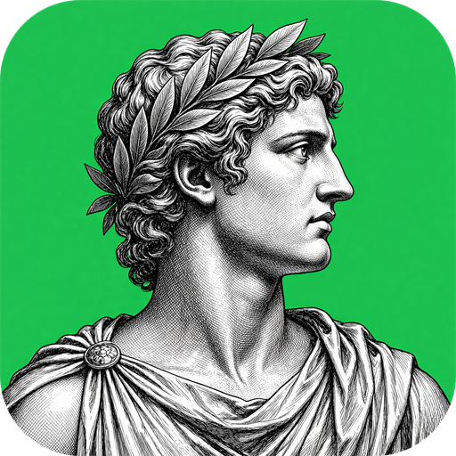

<p align="center">
  
</p>

<h1 align="center">Antigraf</h1>

<p align="center">
  <a href="README.md">English</a> ·
  <a href="README.ja.md">日本語</a> ·
  <a href="README.zh.md">简体中文</a> ·
  <a href="README.zh-hant.md">繁體中文</a> ·
  <b>한국어</b> ·
  <a href="README.es.md">Español</a> ·
  <a href="README.fr.md">Français</a> ·
  <a href="README.vi.md">Tiếng Việt</a> ·
  <a href="README.pt.md">Português</a>
</p>

<p align="center">
  <b>그리스어 <i>antígrafo</i>(αντίγραφο)에서: 원본에 응답하는 사본.</b><br>
  AI 코딩 에이전트를 위한 복제·클론·조사 스킬.<br>
  원본을 먼저 조사하고, 당신의 버전을 만들고,
  <b>얼마나 가까운지를</b> 다시 돌릴 수 있는 명령으로 증명합니다.
</p>

<p align="center">
  
  
  
  

  
  
</p>

<p align="center">
  <a href="#작동-방식">작동 방식</a> ·
<a href="#네-가지-작업">네 가지 작업</a> ·
<a href="#다른-점">다른 점</a> ·
<a href="#어디에-무엇이-있나">어디에 무엇이 있나</a> ·
<a href="#설치">설치</a> ·
<a href="#사용법">사용법</a> ·
<a href="#자주-묻는-질문">자주 묻는 질문</a> ·
<a href="#정직한-현황">정직한 현황</a> ·
<a href="#라이선스">라이선스</a> ·
<a href="#기여와-보안">기여와 보안</a> ·
<a href="#넘지-않는-선">넘지 않는 선</a>
</p>

<br>

Antigraf는 지시문과 작은 도구 모음으로 당신의 에이전트 안에 자리합니다. 웹사이트, 휴대폰 앱, 게임을 따라가며 모든 부분을 숫자로 기록하고, 당신의 사본을 만든 뒤, 양쪽에 같은 검사를 답하게 합니다. 아무것도 실패하지 않고, 아무것도 '알 수 없음'이 아닐 때까지 계속합니다.

말하고자 하는 것은 "똑같이 보인다"가 아닙니다. 아직 다른 행과, 그것을 보여 주는 명령을 보여 주는 것입니다.

<br>

<b>한마디로:</b> Antigraf는 AI 코딩 에이전트를 위한 1:1 복제 스킬입니다. 웹사이트를 클론하고, 웹 앱이나 게임을 복제하고, 디자인을 당신 것으로 다시 만들고, 사이트가 앞에서 뒤까지 어떻게 만들어졌는지 조사합니다. 첫 페이지만 아니라 전체 페이지를 다룹니다. 모든 경로, 구역, 컨트롤, 열린 상태, 애니메이션, 휴대폰 레이아웃, 오프라인 동작, 3D 장면을 각각 원본과 비교하며, 모두 맞을 때까지 100% 잠금을 열지 않습니다.

<table>
  <tr>
    <td width="25%" valign="top">
      <h3>무엇이든 조사</h3>
      페이지, 화면, 메뉴, 컨트롤, 그리고 클릭 뒤에 숨은 것까지. 모든 숫자에는 출처가 붙어서 추측이 측정인 척할 수 없습니다.
    </td>
    <td width="25%" valign="top">
      <h3>나만의 버전 만들기</h3>
      사본은 당신의 프로젝트 안에, 당신이 고른 기술 조합으로 들어갑니다. 권리가 있는 것 말고는 원본에서 가져오지 않습니다.
    </td>
    <td width="25%" valign="top">
      <h3>검증, 추측 아님</h3>
      27개 검사가 매 회 양쪽에서 실행됩니다. 실행되지 않았거나 '알 수 없음'이라고 답한 검사는 잠금을 막고, 통과로 세지 않습니다.
    </td>
    <td width="25%" valign="top">
      <h3>에이전트 대응</h3>
      스킬 파일과 순수 스크립트만으로, 어떤 모델과 어떤 환경이든 같은 검사를 돌립니다. 측정에 AI는 필요 없습니다.
    </td>
  </tr>
</table>

<br>

## 작동 방식

대상을 지정하고 작업을 고르면 다섯 단계로 진행됩니다.

1. **조사:** 대상을 따라가고, 누른 뒤에 숨은 것까지 열어 숫자로 기록합니다.
2. **계획:** 페이지, 구획, 컨트롤, 상태, 경로마다 한 행을 쓰고, 그것을 판정할 검사를 정합니다.
3. **제작:** 화면부터 만듭니다. 서버 쪽은 이름만 적고 복사하지 않습니다.
4. **대조:** 같은 검사를 원본과 사본 양쪽에서 회를 거듭해 실행합니다.
5. **다듬기:** 실패한 행은 다음 제작 지시로 돌아가고, 잠금이 닫힐 때까지 반복합니다.

## 네 가지 작업

`/antigraf`는 무엇보다 먼저 한 가지만 묻습니다.

| # | 작업 | 내용 |
|---|---|---|
| **1** | **복제** | 1:1로 복제합니다. 더 묻지 않고 목표를 100%로 고정합니다. |
| **2** | **재구성** | 나만의 버전으로 만듭니다. 색, 브랜드, 아이콘, 문구 등 무엇을 바꿀지 묻습니다. |
| **3** | **개선** | 대상과 당신의 프로젝트를 나란히 놓고, 상대가 더 잘한 점을 보여 주고, 다음에 할 일을 짧게 정리합니다. |
| **4** | **연구** | 읽기만 합니다. 아무것도 실행하지 않고 민감 정보는 가립니다. 겉부터 속까지 무엇으로 만들어졌는지. |

모든 작업은 마지막에 영역별 1~100의 정직한 표, 각 영역을 붙잡고 있는 것, 다음에 무엇을 할지 선택지를 냅니다.

## 다른 점

| | **Antigraf** | 흔한 복제 스킬 |
|---|---|---|
| 실행 위치 | 어떤 환경, 어떤 모델이든. Python 3와 Node 표준 라이브러리만 | 특정 에이전트 루프에 묶임 |
| "완료"를 정하는 법 | 27개 검사, 각자 종료 코드가 있고 매 회 전부 실행 | 모델이 비슷해 보인다고 말함 |
| "비교하지 않음" | 항상 잠금을 막음 | 통과로 세는 경우가 많음 |
| 받아들인 차이 | 당신만 쓸 수 있고, 조용히 사라지지 않음 | 모델링되지 않음 |
| 큰 작업 | 레인으로 나누고 도움은 최대 3개, 60분 만료 규칙 | 길게 한 번 실행하며 서서히 어긋남 |
| 자기 자신에 대한 주장 | 실제 실행 기록에서 생성되는 진행 표 | 페이지에 적힌 대로 |

총점 하나로 어느 행이 실패했는지 숨기지 않습니다. 그림만으로는 어떤 검사도 통과하지 않습니다. 약한 모델이나 그림을 볼 수 없는 모델은 기준을 낮추지 않고, 덜 쓰고 그렇다고 말합니다.

## 어디에 무엇이 있나

| 경로 | 내용 |
|---|---|
| `skills/antigraf/SKILL.md` | 스킬 본체: 작업, 단계, 계층, 작업 공간, 라운드, 규칙 |
| `skills/antigraf/README.md` | 전체 문서: 검사 항목, 허용 오차, 진행 상황, 배치 |
| `skills/antigraf/references/` | 12가지 지침: 검사, 계획, 충실도, 장면, 인계, 근거 |
| `skills/antigraf/scripts/` | 47가지 도구: Python 40, 브라우저 7, 기기 목록 1 |
| `assets/` | 아이콘, 512와 128 픽셀 |

약속은 이 페이지에, 각 검사의 정확한 허용 오차는 전체 문서에 있습니다.

## 설치

패키지 관리자도, `pip install`도, 계정도 없습니다. 글과 순수 스크립트의 폴더입니다.

**방법 1: 폴더 복사(권장)**

```bash
git clone https://github.com/xC3FFF0E/Antigraf.git
```

`Antigraf/skills/antigraf/`를 당신의 에이전트가 스킬을 읽는 곳으로 옮깁니다. 이름도 `SKILL.md`의 위치도 그대로, `references/`와 `scripts/`도 함께 갑니다.

| 환경 | 폴더 위치 |
|---|---|
| 프로젝트 자체 스킬 폴더 | `<프로젝트>/.claude/skills/antigraf/` |
| 이 컴퓨터의 모든 프로젝트 | `~/.claude/skills/antigraf/` |
| 그 밖의 환경 | 당신의 환경이 읽는 스킬 폴더 |

**방법 2: 폴더에 넣을 수 없을 때**

`skills/antigraf/SKILL.md`의 내용을 에이전트의 사용자 지정 지시문 칸에 붙입니다. 그러면 도구 없이 그 글만으로 돌아가고, 검사는 모델이 손으로 하며 마지막 표에 그렇게 적힙니다.

**방법 3: 에이전트 없이**

도구는 평범한 스크립트입니다.

```bash
cd skills/antigraf
python scripts/antigraf_mode.py --choose 1 --target https://example.com
```

필요한 것: **Python 3.8 이상**(표준 라이브러리만), 브라우저 도구에는 **Node 18 이상**, 따라가고 누르려면 Chromium 계열 브라우저(Edge 또는 Chrome). 모두 선택 사항입니다. 하나가 없으면 단계를 내리고, 추측하지 않고 마지막 표에 적습니다.

## 사용법

한 줄이면 충분합니다.

```
/antigraf https://example.com
```

거기서 여섯 단계로 진행됩니다.

| 단계 | 무슨 일이 일어나는가 |
|---|---|
| **1. 작업 묻기** | 1 복제, 2 재구성, 3 개선, 4 연구. 답하기 전에는 아무것도 복제하지 않습니다. |
| **2. 꼭 필요한 것만 묻기** | 복제는 더 묻지 않습니다. 재구성은 무엇을 바꿀지, 개선은 당신의 프로젝트와 진짜 목적을, 연구는 깊이와 중요한 부분을 묻습니다. |
| **3. 지켜보는 계획 쓰기** | 최대 일곱 단계, 당신의 말로. 하나에 '여기서 멈춤'을 붙이고 디스크에 저장해 다른 모델이 같은 단계에서 이어 갑니다. |
| **4. 조사, 계획, 제작, 측정** | 같은 검사를 원본과 사본에서 회를 거듭해 실행합니다. |
| **5. 차이 닫기** | 실패한 행은 다음 제작 지시로 돌아가고, 전에 통과했는데 지금 실패하는 행은 퇴행으로 표시됩니다. |
| **6. 표 내기** | 아홉 영역, 각 100점 만점, 붙잡고 있는 것을 지목. 그다음 선택지. |

마지막 표는 이렇게 나오며, 기록에서 계산되고 모델이 타이핑하지 않습니다.

```
Area                    Score  pass  fail  unknown  What holds it
----------------------  -----  ----  ----  -------  ----------------------
Words & layout           100%     3     0        0
Design, icons             50%     1     1        0  failing: G4
Behaviour, flows          20%     1     3        1  failing: G6, G7, G23
Phone & PWA              100%     2     0        0
Motion & 3D               33%     1     0        2  not measured: G25, G26
Media & speed            100%     2     0        0
Accessibility              0%     0     1        0  failing: G9
Sources, repairs          75%     3     0        1  not measured: G22
Evidence, proof, pages    40%     2     2        1  failing: G11, G12
```

실행되지 않았거나 알 수 없다고 답한 검사는 **0점**이라 총점이 사본을 좋게 보이게 할 수 없습니다. 모든 작업은 이 표와 세 가지 제안으로 끝납니다. 더 밀어붙이기, 서명한 예외로 차이 받아들이기, 멈추기.

잠금은 **100%**에서만 닫힙니다. 모든 행이 통과하고, 알 수 없는 것이 없고, 설명되지 않는 차이가 없을 때입니다. 그전까지 표는 열려 있는 것을 검사와 행으로 보여 줍니다. 예: `G5 @1440 hero pad 16 12 -4 +-4`.

## 자주 묻는 질문

**사이트 전체를 복제하나, 첫 페이지까지만인가?**
같은 사이트의 링크를 모두 따라가며 각 페이지를 세 가지 폭과 휴대폰, 태블릿에서 기록합니다. 닿지 못한 페이지와 누르지 못한 컨트롤은 '미탐사'로 기록되어 잠금을 막습니다. 찾은 페이지 수와 지나간 페이지 수를 항상 보여줍니다.

**원본의 소스 코드를 주나?**
아니요. 원본을 측정하고 당신이 고른 기술로 당신의 버전을 만듭니다. 받는 것은 당신의 코드이고, 상대 코드의 사본이 아닙니다.

**이미지를 볼 수 없는 모델에서도 되나?**
됩니다. 디자인은 숫자로 전달합니다. 크기, 색, 간격, 글자 크기, 누를 수 있는 영역. 이미지는 비교에만 쓰고 학습에는 쓰지 않으므로 텍스트만 보는 모델도 측정값으로 만듭니다.

**무엇을 복제하지 않나?**
서버 쪽 로직, 인증 정보, 세션 토큰, 결제와 회계 데이터입니다. 그 모양의 필드를 만나면 즉시 멈추고 `HANDOVER.md`에 적습니다. 무엇을 직접 연결해야 하는지 알 수 있게 하기 위해서입니다.

**정말 되었는지 어떻게 아나?**
검사마다 종료 코드가 적힌 파일을 남기고, 마지막 표는 그 기록에서 계산됩니다. 돌지 않았거나 '모름'이라고 답한 검사는 0점입니다. 모델이 자기 점수를 적을 수 없습니다.

**어떤 종류의 원본을 다루나?**
웹사이트와 여러 페이지 웹 앱, 휴대폰 우선 앱과 PWA 동작, 플레이어가 있는 스트리밍 화면, 상점과 목록, 문서 사이트, 그리고 그리기 호출·셰이더·움직임까지 포함한 3D 장면입니다.

**실행에 무엇이 필요한가?**
Python 3.8 이상(표준 라이브러리만), 브라우저 도구에는 Node 18 이상, Chromium 계열 브라우저. 패키지 설치도, 계정도, 키도 필요 없습니다.

## 정직한 현황

여기서는 두 숫자를 일부러 나눠 보여줍니다. 점수는 실제 원본과 복사본 한 쌍에 대해 게이트가 말하는 값이고, 증명된 수는 모든 게이트를 통과한 쌍의 수입니다. 도구가 끝났는지를 정하는 것은 두 번째입니다.

**능력은 주장이 아니라 측정입니다.** 아래 게이트는 모두 존재하고 실행됩니다. 실제로 통과한 것은 한 쌍의 점수와 따로 셉니다.

<!-- ANTIGRAF:SCORE (written by scripts/antigraf_registry.py - do not edit by hand) -->

**Measured: 73.7% out of 100 - the three-page test pair (round 5)**

| Area | Score | Passing | Failing | Not measured | What holds it down |
|---|---|---|---|---|---|
| Words & layout | 100% | 3 | 0 | 0 | - |
| Design, icons | 100% | 2 | 0 | 0 | - |
| Behaviour, flows | 20% | 1 | 3 | 1 | failing: G6, G7, G23 |
| Phone & PWA | 100% | 2 | 0 | 0 | - |
| Motion & 3D | 33% | 1 | 0 | 2 | not measured: G25, G26 |
| Media & speed | 100% | 2 | 0 | 0 | - |
| Accessibility | 100% | 1 | 0 | 0 | - |
| Sources, repairs | 100% | 4 | 0 | 0 | - |
| Evidence, proof, pages | 40% | 2 | 2 | 1 | failing: G11, G12 |
| **Total** | **73.7%** | 18 | 5 | 4 | 9 gate(s) not passing |

The lock needs 100%: every gate passing, nothing unknown. A gate that never ran counts as zero, not as a pass.

<!-- /ANTIGRAF:SCORE -->

### 게이트별 주장

<!-- ANTIGRAF:PROGRESS (written by scripts/antigraf_registry.py - do not edit by hand) -->

**27 gates  ·  0 proven on a real original-to-copy pair  ·  1 measured so far**

| What the gates check | Gates | State | Where it was measured |
|---|---|---|---|
| Look: sections, words, colours, spacing | G2, G3, G4, G5 | measured | the three-page test pair round 5 |
| Icons and pictures, one partner each | G8, G17 | measured | the three-page test pair round 5 |
| Every page walked, planned and shipped | G11 | measured | the three-page test pair round 5 |
| Behaviour: pressed, and the same result | G7, G23, G24 | measured | the three-page test pair round 5 |
| States: hover, focus, open, empty, error | G6 | measured | the three-page test pair round 5 |
| Motion: durations, easings, scroll | G13 | measured | the three-page test pair round 5 |
| Phone, install and offline (PWA) | G9, G14, G18 | measured | the three-page test pair round 5 |
| Speed and weight budgets | G15 | measured | the three-page test pair round 5 |
| Logic: same input, same answer, no secrets | G19 | measured | the three-page test pair round 5 |
| Defects found, and the copy repaired | G20, G21 | measured | the three-page test pair round 5 |
| 3D scene read as numbers | G25 | measured | the three-page test pair round 5 |
| 3D motion compared frame by frame | G26 | measured | the three-page test pair round 5 |
| Server seams listed for you to hook up | G16 | measured | the three-page test pair round 5 |
| Evidence, proof and a frozen plan | G0, G1, G10, G12 | measured | the three-page test pair round 5 |

| Target | Family | Kind | Gates passed | Failed | Unknown | Verdict |
|---|---|---|---|---|---|---|
| the three-page test pair | unknown | round 5 | 18 of 27 | 5 | 4 | measured |

`proven` means every gate ran, passed, and nothing was unknown. `measured` means the gates ran and left a real exit code. Anything else is `not proven`, and is not being claimed.

<!-- /ANTIGRAF:PROGRESS -->


**측정하는 쪽은 작동합니다. 만드는 쪽은 아직 모든 검사를 통과하는 사본을 한 번도 만들지 못했습니다.**

전체 문서의 진행 표는 디스크의 기록에서 쓰이고 손으로 쓰지 않습니다. 현재 27개 검사, 실제 원본과 사본 조합에서 증명된 것은 0입니다. 백 점과 거짓말보다 영 점과 이유를 보여 주겠습니다.

## 라이선스

**Apache License 2.0**([LICENSE-APACHE](LICENSE-APACHE)) 또는 **MIT**([LICENSE-MIT](LICENSE-MIT)) 중 하나를 고르세요. 짧은 설명과 라이선스가 적용되지 않는 범위는 [LICENSE.md](LICENSE.md)에 있습니다. 아이콘과 이름은 프로젝트에 남습니다. 포크는 포크임을 밝히면 괜찮습니다.

## 기여와 보안

변경을 제안하는 방법과, 가장 중요한 단 하나의 규칙(새 검사는 먼저 실패하는 모습을 보여야 합니다)은 [CONTRIBUTING.md](CONTRIBUTING.md)에 있습니다. 취약점을 비공개로 알리는 방법과 Antigraf가 보호하는 것과 보호하지 않는 것은 [SECURITY.md](SECURITY.md)에 있습니다.

## 넘지 않는 선

Antigraf가 복사하는 것은 페이지의 겉모습과 브라우저에서의 동작입니다. 서버 쪽 로직, 자격 증명, 세션 토큰, 결제나 회계 데이터는 **복사하지 않습니다**. 그런 모양의 항목을 발견하면 멈추고 거부합니다. 대신 `HANDOVER.md`에 적어, 당신의 백엔드에 무엇을 연결해야 하는지 합법적으로, 당신의 조건으로 알려 줍니다.

**해적판, 계정 공유, 유료 장벽·DRM·로그인 우회, 사적 데이터 수집, 권리 없는 콘텐츠·브랜드·자산의 복제를 우리는 용인하지 않습니다.** 당신이 가진 것, 공개 허락이 있는 것, 조사 허가가 있는 것에 쓰세요. 권리 없는 이미지, 글꼴, 로고, 문구는 당신의 것으로 바꾸고, 아무도 확인하지 않은 라이선스는 확인하거나 교체할 때까지 잠금을 막습니다.

<br>

<p align="center">
  <br>
  <sub>Antigraf. AI 코딩 에이전트를 위한 복제·클론·조사 스킬.</sub>
</p>
