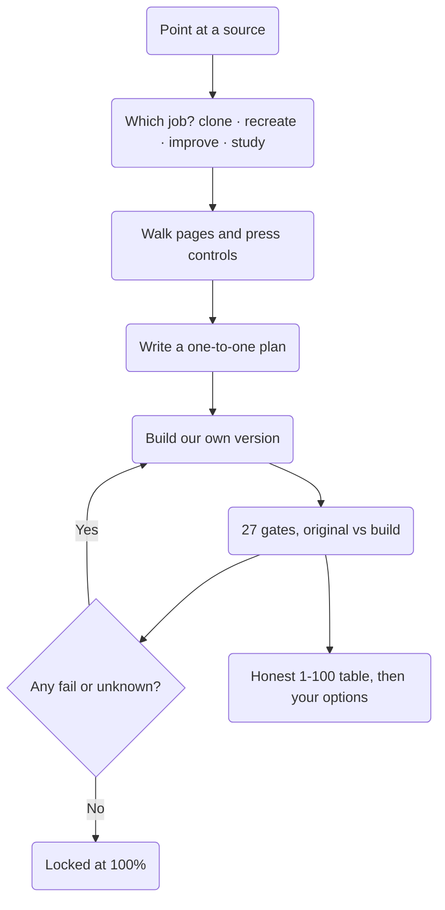

<h1 align="center">Antigraf</h1>

<p align="center">
  <b>From the Greek <i>antígrafo</i> (αντίγραφο) — a copy that answers the original.</b><br>
  A skill that studies a source, builds your own version of it, and <b>proves</b> how close it is<br>
  with commands you can re-run, instead of screenshots and opinions.
</p>

<p align="center">
  
  
  
  
  
</p>

<br>

| | **Antigraf** | A typical clone skill |
|---|---|---|
| Where it runs | Any harness, any model. Python 3 and Node, standard library only | Tied to one agent loop |
| How it decides "done" | 27 gates, each with its own exit code, all run every round | The model says it looks right |
| "Not compared" | Always blocks the lock | Usually counted as a pass |
| Differences you accept | Yours alone, written by you, never quietly dropped | Not modelled |
| Big jobs | Split into lanes, 3 helpers at most, a 60-minute stale rule | One long run that slowly drifts |
| What it claims about itself | A registry generated from real ledgers | Whatever the page says |

## Four jobs

`/antigraf` asks one question first. Nothing is copied until you answer it.

| Job | What it does |
|---|---|
| **1 Clone** | Copy the source 1:1. It asks nothing else, and locks the target at 100%. |
| **2 Recreate** | Copy the source as your own version. It asks what should change: colours, branding, icons, copy. |
| **3 Improve** | Put a source against your own project, show what the source does better, and end with a short list of what to do next. |
| **4 Study** | Read only, nothing executed, secrets redacted. What it is built with, front to back. |

## How it works



Every round is one command, identical on every machine:

```
python scripts/antigraf_round.py --original capture --copy checks/round-3 \
    --plan plan.json --waivers waivers.json --build "npm run build"
```

## What it measures

Values are compared as numbers, not as impressions. Tolerances are stated and fixed:
**±2 px** on type, **±4 px** on padding and gaps, **±8 px** on the content column; exact on colours,
radii, icons, items per row, and behaviour. The same comparison runs again on **10 real devices**,
from an iPhone SE to a 1920 desktop, each keeping its own picture in the run folder.

| Area | What is compared |
|---|---|
| Look | Sections, blocks and their order, every visible word, colours, type, radii, shadows, columns, padding, gaps, heights |
| Icons and pictures | One partner each, judged on shape, size and place; alt text and load state |
| States | Hover, focus, open, empty, loading, error, success — each paired to the same state on the original |
| Behaviour | Every press, keystroke and scroll replayed; the player HUD, drawers and overlays recorded while open |
| Motion | Durations, easing, delays, direction, loops, scroll effects |
| 3D | Objects, materials, lights, camera, shadows, tone mapping, drawn counts, and frame-by-frame motion |
| Phone and PWA | Manifest, icons, theme colour, offline page, install, safe areas, 44 px tap targets |
| Speed | Image sizes and formats, lazy loading, font handling, total weight |
| Pages | Found, planned and shipped, checked in both directions |
| Repair | Every fault of the original is found, and the copy must fix it rather than repeat it |

## Current progress

This block is written by `scripts/antigraf_registry.py` from the proof ledgers on disk. It cannot be
typed by hand, so it cannot drift from reality.

<!-- ANTIGRAF:PROGRESS (written by scripts/antigraf_registry.py - do not edit by hand) -->

**27 gates  ·  0 proven on a real original-to-copy pair  ·  1 measured so far**

| What the gates check | Gates | State | Where it was measured |
|---|---|---|---|
| Look: sections, words, colours, spacing | G2, G3, G4, G5 | measured | the three-page test pair round 3 |
| Icons and pictures, one partner each | G8, G17 | measured | the three-page test pair round 3 |
| Every page walked, planned and shipped | G11 | measured | the three-page test pair round 3 |
| Behaviour: pressed, and the same result | G7, G23, G24 | measured | the three-page test pair round 3 |
| States: hover, focus, open, empty, error | G6 | measured | the three-page test pair round 3 |
| Motion: durations, easings, scroll | G13 | measured | the three-page test pair round 3 |
| Phone, install and offline (PWA) | G9, G14, G18 | measured | the three-page test pair round 3 |
| Speed and weight budgets | G15 | measured | the three-page test pair round 3 |
| Logic: same input, same answer, no secrets | G19 | measured | the three-page test pair round 3 |
| Defects found, and the copy repaired | G20, G21 | measured | the three-page test pair round 3 |
| 3D scene read as numbers | G25 | measured | the three-page test pair round 3 |
| 3D motion compared frame by frame | G26 | measured | the three-page test pair round 3 |
| Server seams listed for you to hook up | G16 | measured | the three-page test pair round 3 |
| Evidence, proof and a frozen plan | G0, G1, G10, G12 | measured | the three-page test pair round 3 |

| Target | Family | Kind | Gates passed | Failed | Unknown | Verdict |
|---|---|---|---|---|---|---|
| the three-page test pair | unknown | round 3 | 15 of 27 | 12 | 0 | measured |

`proven` means every gate ran, passed, and nothing was unknown. `measured` means the gates ran and left a real exit code. Anything else is `not proven`, and is not being claimed.

<!-- /ANTIGRAF:PROGRESS -->

The honest position: **the measuring half works. The building half has not yet produced a copy that passed every gate.** A study of a real multi-page site recorded a set of pages, pressed a set of controls, and opened the player behind one of them; the gates answered eight passed and fifteen open. A scene gate read 28,116 triangles and 11 shaders from a page that never exposed its own scene, then compared a copy against itself at 98.9 per cent frame likeness. That proves the check, not the copy.

We would rather show you a zero and the reason than a hundred and a lie.

## Start here

1. Install the pack so `SKILL.md` is the instruction text.
2. Type `/antigraf` and answer the first question: which of the four jobs.
3. Answer only what is truly yours: artwork you do not own, branding, a stack you care about.
4. Read the closing table: the 1–100 per area, what holds each area down, and your options.

A model that cannot see pictures uses the measurements instead and reports pictures as uncompared.
A model with no browser still reads files in full study and names the checks it could not run. A
weaker model never lowers a bar — it lowers how much is spent, and says so.

## Repository layout

| File | What it is |
|---|---|
| `SKILL.md` | the skill: the four jobs, stages, tiers, workspace, gates, rounds, the rules |
| `references/gates.md` | all 27 gates, their tolerances, severities, and the lock rule |
| `references/planning.md` | the unit cut, one-to-one pairing, per-unit pass rules, `plan.json` |
| `references/fidelity.md` | what "same" means for each kind: sites, phone, 3D, motion |
| `references/scene.md` | reading a 3D scene and its motion as numbers |
| `references/handover.md` | the server pieces never copied, and what you must hook up |
| `references/scripts.md` | every tool, what it runs, what it refuses to do |
| `references/lean-voice.md` | how to spend less without lowering the bar |
| `references/evidence.md`, `coverage-and-proof.md`, `builder-brief.md`, `stacks.md`, `glossary.md` | study, coverage, brief, stacks, plain words |
| `scripts/` | 39 Python tools, 7 browser tools, and one device list |

---

## The line we do not cross

Antigraf copies how a page looks and how it behaves in your browser. It does **not** copy server-side
logic, credentials, session tokens, payment or accounting data, and it stops and refuses when it
finds a field shaped like one of those. Those pieces are written into `HANDOVER.md` instead, so you
know exactly what to wire to your own backend, legally and on your own terms.

**We do not condone piracy, account sharing, paywall, DRM or login bypass, private-data scraping, or
reproducing anyone's content, brand or assets without permission.** Use Antigraf on what you own,
what is openly licensed, or what you have been given leave to study. Artwork, fonts, logos and copy
you have no rights to are replaced with your own, and a licence nobody cleared holds the lock until
you clear it or swap it out. What you build is yours only if what you put in it is yours to put in.
